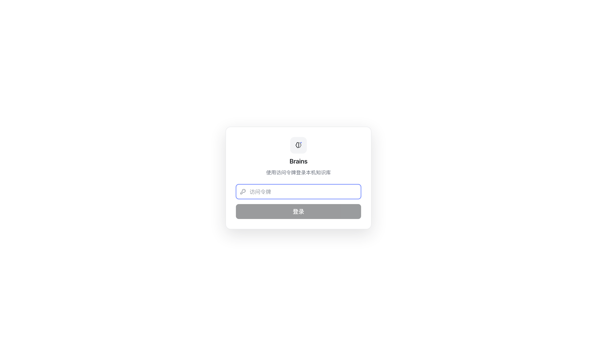
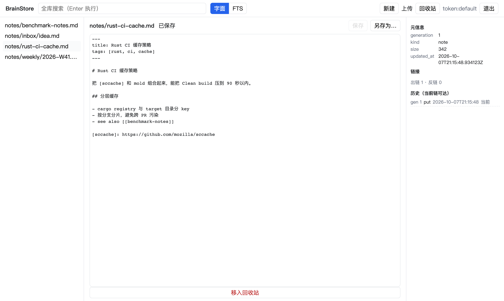
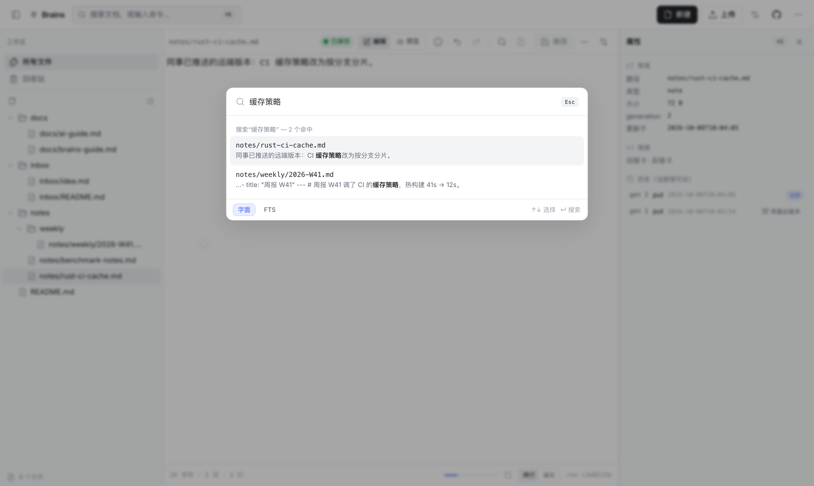
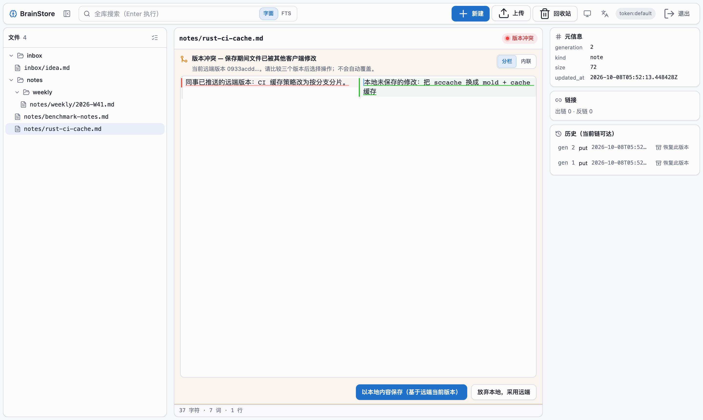
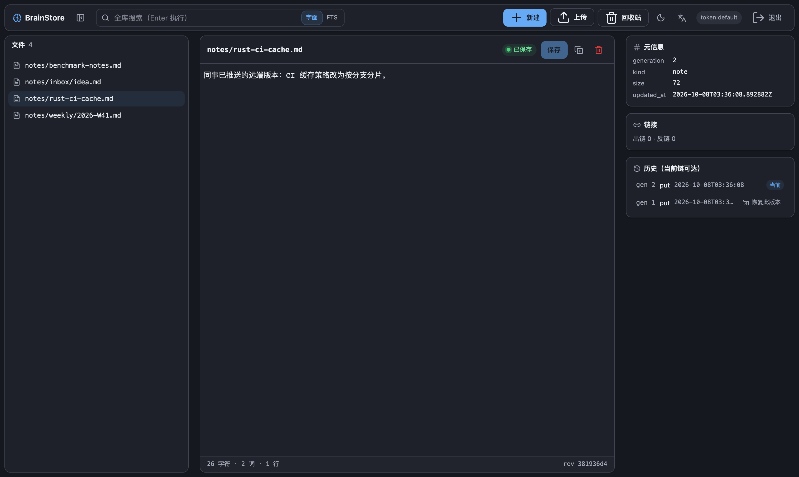

# Brains

<p align="left"></p>

**面向人类、可迁移的长期知识库——进来的是普通文件，出去的也是普通文件，且每一版都留着。**

[English](README.md) · [架构文档](docs/architecture.md) · [运行手册](docs/runbook.md) · [验证记录](docs/verification.md)

[](https://github.com/unic/brains/actions/workflows/ci.yml)

Brains **不是** AI memory framework：没有召回引擎、没有向量库、没有上下文装配。它只做一件事——为已经在写的笔记提供版本化存储，核心承诺是：**数据库可以消失，正文和历史不能。**

| 登录 | 工作台 |
|---|---|
|  |  |
| *全库搜索* | *冲突工作台——分栏/内联 diff，绝不自动覆盖* |
|  |  |
| *暗色主题* | |
|  | |

Web 界面内置 **暗色 / 亮色 / 跟随系统** 三档主题与 **命名空间化 i18n（简体中文 / English，基于 i18next）**，均可在顶栏一键切换并按浏览器记忆。

## 核心性质

- **开箱即有内容，不是空白屏。** 首次启动空库自动播种四篇模板笔记——欢迎页、使用规则、**AI 协作守则**与收件箱，人和 agent 都从可用的约定开始（云端实例用 `bsx seed`）。
- **对 AI 天然友好。** [docs/ai-integration.md](docs/ai-integration.md) 是面向机器的 API 参考（端点、CAS 礼仪、错误模型），`llms.txt` 为爬虫/agent 提供项目索引，且每个库内部自带精简守则（`docs/ai-guide.md`）。

- **不可变修订 + 唯一原子提交点。** 每次保存写入内容寻址的 blob 与修订记录，再以 CAS（compare-and-swap）原子替换该路径的 HEAD。两个客户端基于同一版本并发保存：恰好一个成功，另一个收到携带当前版本的 `412`——不存在静默覆盖。
- **冲突是一等公民。** 冲突工作台提供 VSCode 式 **分栏**（远端 vs 本地并排、差异块双侧同步高亮）与 **内联**（逐块 Accept/Reject）两种 diff 视图，均可编辑；"以本地保存"或"采用远端"必须由人决定；决策期间远端再变会再次冲突，绝不自动重试。编辑中还可一键开启 **与已保存基线的内联 diff**，未保存的改动一目了然，支持逐块回退。
- **真编辑器，不是文本框。** CodeMirror 提供查找替换（大小写/正则/全词、全部替换）与选区匹配高亮；侧栏为文件夹树，支持 **多选批量操作**（批量移入回收站 / 批量恢复）。
- **删除是墓碑，恢复是新版本。** generation 只前进不倒退；历史面板可把任意有内容的版本恢复为新修订。
- **本地与云端 profile 双向同步。** `bsx sync` 依据逐文件 revision 基线与 CAS 传递变更；无重叠文本修改自动合并，分歧文件保留两侧内容并交由用户明确解决。
- **磁盘布局即备份。** `vaults/{vault}/heads|revisions|blobs`——拷贝目录即完整裸备份；索引（SQLite/D1）是可随时删除重建的投影。
- **一份 HTTP 契约，三类客户端。** Web、Rust CLI、curl/agent 走同一套版本化 REST API；两个运行时（原生 Axum 与 Cloudflare Worker）复用同一 axum 层。
- **一切有界。** 字面检索是有界窗口、绝不伪造"已搜完全库"；索引损坏时响亮降级（`503` / `building`）；超限文本只存储、不入索引。

## 快速开始（本地 profile）

```bash
cargo build -p brains-server -p brains-cli
pnpm --dir apps/web build

# 一条命令起全栈（API + Web 同域）
./target/debug/brains-server \
  --data-dir ./brain-data \
  --token "$MY_TOKEN" \
  --web-dist apps/web/dist
# → http://127.0.0.1:45800 （把 token 粘进登录页）
```

CLI 对接同一服务：

```bash
./target/debug/bsx profile add local --url http://127.0.0.1:45800 --token "$MY_TOKEN"
./target/debug/bsx ls ""
echo "# hello" > /tmp/hello.md && ./target/debug/bsx put notes/hello.md --from /tmp/hello.md --create
./target/debug/bsx search "关键词"
```

认证模型、备份布局、索引重建与排障见[运行手册](docs/runbook.md)。

## Cloudflare 本地模拟（无需云账号）

同一 axum 层以 Worker 形态运行在 R2（内容）+ D1（可重建索引）之上。`wrangler dev` 在本地 workerd 里执行，R2/D1 均为本地模拟——**协议行为与生产一致**：

```bash
rustup target add wasm32-unknown-unknown
cargo install worker-build --locked
pnpm --dir apps/web build
cd apps/worker
RUSTFLAGS='--cfg getrandom_backend="wasm_js"' worker-build --release
pnpm exec wrangler d1 migrations apply BRAINS_INDEX --local
pnpm exec wrangler dev --port 8799          # → http://localhost:8799
bash tests/worker-smoke.sh                  # CAS 竞争、搜索、回收站/恢复验收
```

本地 workerd 已验证的验收项：**12 个浏览器 E2E 用例对 Worker 原样全量通过**；同基线并发双写恰好一方 `200` 一方 `412`；trash→410→restore 产生新 generation；删掉 D1 库再 `reindex` 后搜索结果一致；CLI 与导出对 Worker 原样可用。**真实账户部署是下一个里程碑，当前不宣称已完成**（见[验证记录](docs/verification.md)）。

## 架构

```
浏览器 ──/ (静态)──▶ Workers Static Assets  │  原生 Axum + web dist
CLI / curl ──/api/v1/*──┐
                        ▼
      共享 axum 层（crates/api-http）：路由 · 错误映射 · 鉴权
                        │
      ┌─────────────────┴──────────────────┐
      ▼ local-rust profile                ▼ cloudflare-rust profile
  文件系统 + 跨进程锁（HEAD CAS）       R2 binding（存储 ETag 作 CAS token）
  SQLite（可重建索引）                 D1 binding（同一份 SQL，可重建）
      apps/server                          apps/worker（workers-rs）
```

| Crate | 职责 |
|---|---|
| `crates/domain` | 路径、HEAD/Revision、错误分类、能力报告 |
| `crates/format` | 有界 frontmatter/Markdown 解析、链接提取 |
| `crates/ports` | 存储 trait——CAS HEAD、create-only blob/revision、索引（刻意不强制 `Send`，Worker 侧桥接 `!Send` future） |
| `crates/application` | 全部业务编排：提交管线、搜索、恢复、patch、copy/move、reindex |
| `crates/api-http` | 两个运行时共享的 HTTP 层（路由、错误映射、鉴权） |
| `crates/adapter-fs` / `adapter-sqlite` | 本地 profile 适配器 |
| `crates/adapter-r2` / `adapter-d1` | Worker profile 适配器（同键布局、同 SQL） |
| `crates/client` | CLI 的类型化 HTTP 客户端：条件写、两阶段导出 |
| `apps/web` | React + CodeMirror 编辑器（显式 load/clean/dirty/saving/conflict 状态机） |
| `apps/server` · `apps/worker` | 各 profile 的薄装配 |

## 测试

- **79 个 Rust 测试**——domain、format、适配器、27 个业务测试（真实 fs+SQLite，注入 CAS/索引故障）、HTTP 与 CLI 契约测试。
- **12 个浏览器 E2E**——SerenityJS screenplay pattern 对真实服务器：登录、创作、CAS 冲突与再冲突、字面/FTS 搜索、回收站/恢复、历史恢复。
- **Worker 业务冒烟**——同一验收清单对 workerd 执行（`tests/worker-smoke.sh`）。

```bash
cargo fmt --all -- --check && cargo clippy --workspace --all-targets --all-features -- -D warnings
cargo test --workspace --all-features
pnpm --dir apps/web build && pnpm --dir tests/e2e exec playwright test   # 需 BRAINS_SERVER_BIN/BRAINS_WEB_DIST
bash tests/worker-smoke.sh                                               # 对运行中的 wrangler dev
```

## CI · 发布 · 部署

| Workflow | 触发 | 内容 |
|---|---|---|
| [ci.yml](.github/workflows/ci.yml) | push / PR | fmt · clippy `-D warnings` · 79 测试 · SDK 代码生成漂移检查 · wasm 检查 · web 构建 · screenplay E2E（原生 **与** Worker）· workerd 业务冒烟 |
| [release.yml](.github/workflows/release.yml) | 打 `v*` tag **或**手动 dispatch | 构建 CLI+server（macOS arm64/x64、Linux musl）、web 产物、Worker 包 → 发布带 SHA-256 的 GitHub Release。一键：*Actions → Release → Run workflow → 填版本号* |
| [deploy.yml](.github/workflows/deploy.yml) | 手动 dispatch | 构建 Worker 并部署到 Cloudflare（`wrangler deploy` + 远端 D1 迁移）。需要 `CLOUDFLARE_API_TOKEN` / `CLOUDFLARE_ACCOUNT_ID` secrets 与文件头部记载的一次性资源开通 |
| dependabot | 每周 | cargo · npm · actions 依赖更新 |

## 状态与如实声明

- local-rust profile：**已完成并验证**（P0 全量 + patch/copy/move/diff/export；四项未交付能力路由返回 `501`、capabilities 报 `false`）。
- cloudflare-rust profile：**已实现并经本地 workerd 验证**；真实账户部署、真实 R2/D1 行为与免费额度 CPU 预算待凭据后验证。
- Windows 与非 Chromium 浏览器未测试；尚未做长时间并发压测。

## 许可

MIT
