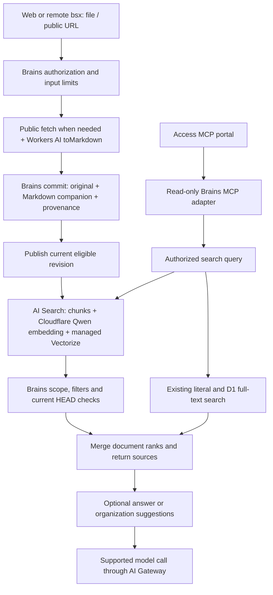

# Cloudflare AI integration plan

Status: proposed for review. Researched on October 27, 2026. This document describes work to implement; it does not advertise deployed capabilities. See [the deployment guide](cloudflare.md) for the existing Worker and [capabilities](capabilities.md) for current runtime support.

## Goal and recommended design

Make document conversion, public URL import and semantic retrieval available to the web app and remote `bsx` clients without requiring a native converter on the client machine. Preserve Brains files, revisions, permissions and source provenance as the authoritative knowledge store.

Use AI Search as the first managed semantic retrieval provider, defaulting to Cloudflare-hosted `@cf/qwen/qwen3-embedding-0.6b` at 1,024 dimensions. This uses AI Search's included internal model usage and requires no external provider key. Keep the model, requested dimensions and retrieval policy configurable, validated against the selected provider's actual capabilities. Google Embedding 2 is an optional multimodal provider. AI Search manages chunking and the vector index; combine its candidates with existing literal and D1 full-text search, then apply Brains permissions and current-revision checks. Initialize user-configurable budgets at 80% of a dated free-tier snapshot covering all used Cloudflare products. See [the unified quota and configuration design](cloudflare-quotas.md).

## Current implementation

| Area | Verified state | Source |
| --- | --- | --- |
| Cloud runtime | Worker API and web app, R2 versioned content, D1 index, existing authentication and conditional writes are deployed. | [Worker](../apps/worker/src/lib.rs), [deployment guide](cloudflare.md) |
| Search | Literal and full-text retrieval work. Hybrid search reports semantic retrieval as unavailable. | [Application search](../crates/application/src/search.rs) |
| Semantic ports | Embedding and vector interfaces exist, but no live cloud provider is wired into application mutations or queries. | [Embedding ports](../crates/ports/src/embedding.rs), [application state](../crates/application/src/lib.rs) |
| Conversion and URLs | Native client operations exist; the Worker has no corresponding cloud operations. | [Conversion](../crates/client/src/convert.rs), [URL import](../crates/client/src/url_import.rs), [API contract](../api/brains.idl) |
| Gateway and MCP | No Brains Gateway integration or MCP endpoint is implemented. | [Worker](../apps/worker/src/lib.rs), [API contract](../api/brains.idl) |
| Tracing | Worker invocation logs and sampled platform traces are configured. Application-level conversion, indexing and retrieval spans still need implementation. | [Wrangler configuration](../apps/worker/wrangler.toml) |

## Service roles

| Service | Role in Brains | Ownership boundary |
| --- | --- | --- |
| Workers AI | Convert supported documents to Markdown; run explicitly selected models for later summaries, suggestions or answers. | Brains owns the original file, generated companion, provenance and write decision. |
| AI Search | Manage document chunking, embedding, asynchronous indexing and semantic candidate retrieval. | Brains publishes eligible revisions and validates every returned candidate. |
| Vectorize | Provide vector storage inside the managed AI Search instance. A standalone index is an alternative implementation if managed retrieval proves insufficient. | The first implementation uses the managed index rather than indexing the same corpus twice. |
| AI Gateway | Apply supported model-call controls and expose model usage, latency and costs. | Model telemetry does not replace file history, index status or authorization. |
| MCP portal | Give an authenticated, tool-limited entry point to a real Brains MCP server. MCP is the protocol AI clients use to call tools. | Access controls portal admission; the upstream server still authenticates and authorizes Brains operations. |
| Agent tracing | Connect actual request steps, model calls and tool calls through spans: timed records within a trace. | Sampled traces explain execution; they are not permanent knowledge or complete audit history. |

AI Search instances include managed storage and a Vectorize index. Their internal Workers AI embedding and reranking are included in AI Search usage, so the default needs neither a second vector ingestion pipeline nor Google credentials. An optional external Google model has separate project quotas and billing. Free operation means staying within the applicable included allowances; it is not unlimited inference. [Built-in storage](https://developers.cloudflare.com/ai-search/configuration/data-source/built-in-storage/), [AI Search Gateway](https://developers.cloudflare.com/ai-search/configuration/models/ai-gateway/).

## Model and dimension policy

| Serving path | Model and dimensions | Supported dimension handling |
| --- | --- | --- |
| Default managed AI Search | `@cf/qwen/qwen3-embedding-0.6b`, 1,024 dimensions, text. | Use the documented fixed dimensions. The current managed creation API does not expose a dimension override. |
| Optional managed AI Search | `google-ai-studio/gemini-embedding-2`, 1,536 dimensions, text/image retrieval. | Validate against the managed model table; do not pass Google's native dimension option through an unsupported API. |
| Self-managed Workers AI + Vectorize | Qwen3 Embedding 0.6B returns 1,024 dimensions. | Its author supports MRL prefixes from 32 to 1,024. Brains can explicitly crop the returned vector, then L2-normalize it, when it owns indexing. |
| Self-managed Google + Vectorize | `gemini-embedding-2`, native default 3,072 dimensions. | Request `outputDimensionality: 1024` to retain one third, or another supported size from 128 to 3,072. Google recommends 768, 1,536 and 3,072; 1,024 is supported but is not a listed recommended size. |

MRL (Matryoshka Representation Learning) trains useful vector prefixes. It is a model capability, separate from whether a hosted API exposes dimension selection. Qwen's Workers AI input schema currently has no dimension parameter, although its author documents prefix truncation followed by L2 normalization. A model without documented prefix support keeps its supported dimensions; arbitrary slicing is rejected. [Managed models](https://developers.cloudflare.com/ai-search/configuration/models/supported-models/), [AI Search creation schema](https://developers.cloudflare.com/api/resources/ai_search/subresources/namespaces/subresources/instances/methods/create/), [Workers AI Qwen API](https://developers.cloudflare.com/ai/models/%40cf/qwen/qwen3-embedding-0.6b/), [Qwen author implementation](https://github.com/QwenLM/Qwen3-Embedding/blob/main/evaluation/qwen3_embedding_model.py).

L2 normalization scales a vector to unit length. Google Embedding 2 automatically normalizes reduced dimensions requested through its API; do not copy Embedding 001's manual-normalization requirement onto it. If Brains crops an already-returned vector itself, normalize the cropped result. Query and document vectors must share the model, effective dimensions and transformation. For managed AI Search, the provider owns this transformation; Brains cannot claim to normalize vectors it never receives. [Google embedding dimensions and normalization](https://ai.google.dev/gemini-api/docs/embeddings#ensuring-quality-for-smaller-dimensions).

The active vector-space identity includes provider/model, effective dimensions, normalization/transformation policy and projection format. Changing any identity component requires a compatible index and rebuilt projections. Reject unsupported dimension settings with a configuration error; do not silently resize, ignore the field or mix incompatible vectors. Dimension reduction saves vector storage and comparison work, but does not inherently reduce input-token charges or prove equal recall.

Google Embedding 2 natively accepts text, images, audio, video and PDF content in one embedding space. Current AI Search documents text/image query paths and document ingestion; its Workers binding currently accepts string content, with image/file parts using REST. A model switch alone does not give Brains an audio/video ingestion or query path. Advertise model modalities separately from the adapter's accepted inputs; add modality-specific validation, limits and original-source provenance before enabling those paths. Keep the default text path usable without a Google key. [Google multimodal model](https://ai.google.dev/gemini-api/docs/models/gemini-embedding-2), [AI Search Workers input contract](https://developers.cloudflare.com/ai-search/api/search/workers-binding/), [REST image queries](https://developers.cloudflare.com/ai-search/api/search/rest-api/#image-queries).

## Data flow

Budget admission runs before controlled conversion, publication and semantic query attempts. Application spans cover admission, conversion, commit, publication, retrieval, validation and tool execution. Gateway telemetry covers only calls that actually pass through the Gateway.

## Cloud conversion and public URL import

Add cloud operations to [the shared API contract](../api/brains.idl), application service and generated SDKs. Dispatch remote `bsx` operations through the server capability; retain the existing native converter for local profiles. A cloud conversion must work when the calling client has no native conversion feature installed.

Read the original through one revision-consistent Vault read. Check source access, destination write access, supported type and byte limits before making a paid or external conversion call. Reject a companion destination equal to the source path. Preserve the original and create or conditionally update a Markdown companion with source revision/hash and converter identity. Repeated conversion of unchanged input must not create content churn solely because a timestamp changes.

Share the pure provenance, companion naming and unchanged-content logic with native conversion. Keep blocking native HTTP/client code outside the Worker. Verify worker-rs support for `toMarkdown`; if required, add a narrow typed JavaScript boundary rather than moving business rules out of Rust. The official API supports conversion through the AI binding and documents format-specific options. [toMarkdown binding](https://developers.cloudflare.com/workers-ai/features/markdown-conversion/usage/binding/).

For URL import, validate public HTTPS destinations and every redirect, reject credentials and private/metadata targets, and enforce total time, redirect and response-size limits. Confirm the runtime's public-only fetch mechanism before relying on hostname checks. Start with public static pages and documents. Return a clear unsupported-rendering result for pages that require JavaScript; Browser Run can be added as an explicit rendering option after its need and costs are verified.

Fetch and convert first, then save through the ordinary Vault commit path. Store a safe source URL and content provenance. Report conversion or commit failure accurately; a saved original with a failed companion must remain identifiable and retryable. AI Search website crawling alone does not create a Brains file or its revision history. [Cloudflare's single-page fetch/index example](https://developers.cloudflare.com/ai-search/how-to/fetch-and-index-web-pages/).

## Managed semantic retrieval

### Publish a current-revision projection

Brains R2 stores HEAD pointers, immutable revision records and all revision blobs. Historical, trashed and uncommitted blobs can remain in the bucket. Publish only committed, live, eligible text through AI Search built-in storage and the Items API; do not configure the whole authoritative bucket as the searchable corpus. Reuse the existing text eligibility and projection rules. [R2 keys](../crates/adapter-r2/src/lib.rs), [revision blob keys](../crates/domain/src/revision.rs), [projection rules](../crates/application/src/commit.rs).

Use one AI Search instance for the current single-vault deployment. A proposed short immutable item key is `p1/<revision>.md`; resolve returned revisions through the existing RevisionStore to recover the official path. Keep any provider item ID and processing state in a small rebuildable projection record, rather than duplicating authoritative file metadata. The `p1` prefix identifies the projection format.

Uploading an item queues indexing; it does not prove the item is searchable. The same item key returns a conflict rather than behaving as an upsert. Distinguish pending, ready and failed processing; inspect an existing item's identity and state on a retry. Publish a new revision before removing the old projection, and bind removal to the specific old revision so a delayed task cannot delete the new one. [Items API](https://developers.cloudflare.com/ai-search/api/items/workers-binding/), [API errors](https://developers.cloudflare.com/ai-search/troubleshooting/api-error-codes/).

Use one application-facing semantic provider boundary for publishing, removing and retrieving projections. The existing low-level embedding/vector ports fit a future self-managed provider; AI Search should not pretend to accept application-generated vectors. Keep provider-specific SDK code at the cloud adapter boundary.

Record pending publication and retry state in D1, using the repository's actual schema/migration mechanism. A bounded background attempt can reduce latency; a scheduled retry and reindex reconciliation provide recovery beyond an individual Worker invocation. Preserve a successful source commit if downstream indexing fails, and expose semantic readiness separately from file-write and lexical-index success. Reuse existing reindex entry points instead of introducing a second content store or a general workflow engine.

All mutation paths need the same lifecycle handling: create, patch, copy, move, trash, restore, purge and archive import followed by reindex. Reconciliation must publish missing current revisions and remove obsolete projection items. Disabling semantic retrieval must not disable ordinary file access or literal/full-text search.

### Validate before returning results

Use AI Search `search()` in vector-only retrieval mode as the semantic branch of existing hybrid search. For every candidate, resolve its revision, verify a live matching HEAD, apply the authorized path boundary and the existing tags/meta rules, and merge repeated chunks of the same document before rank fusion. Build returned snippets from authorized current source content. [Search binding](https://developers.cloudflare.com/ai-search/api/search/workers-binding/), [vector retrieval](https://developers.cloudflare.com/ai-search/configuration/indexing/vector-search/).

AI Search allows only five custom metadata fields, indexes only the first 64 UTF-8 bytes of string filter values, does not filter stored string arrays, and returns at most 50 chunks per search. Metadata can narrow candidates; it cannot implement all Brains path, tags-AND and metadata semantics. Enforce final rules in Brains and report incomplete retrieval when the bounded candidate window prevents a complete answer. Filtered zero hits must not be presented as proof that the entire vault has no matches. [Metadata](https://developers.cloudflare.com/ai-search/configuration/indexing/metadata/), [filtering](https://developers.cloudflare.com/ai-search/configuration/retrieval/filtering/), [search parameters](https://developers.cloudflare.com/ai-search/api/search/workers-binding/).

Use the current `ai_search` / `ai_search_namespaces` binding contracts and `chunks` results rather than the legacy `env.AI.autorag()` interface. Create the default instance with Cloudflare Qwen embedding, its supported 1,024 dimensions, an 8,192-token managed input limit and cosine similarity. Evaluate Chinese, English and long-document retrieval. Embedding selection is creation-time configuration; replacing it requires a new compatible instance and rebuilt projections. Enable an external Google model only through explicit configuration and Gateway BYOK. [Binding migration](https://developers.cloudflare.com/ai-search/api/migration/workers-binding/), [supported models](https://developers.cloudflare.com/ai-search/configuration/models/supported-models/), [model configuration](https://developers.cloudflare.com/ai-search/configuration/models/).

### Rank first, with an optional reranker

Default to ordered candidates and a result count rather than an empirical minimum similarity. AI Search's current request parameter is `match_threshold`, which defaults to `0.4`; explicitly set it to `0`, request up to 50 candidates, validate permissions/current revisions and deduplicate documents, then merge keyword/vector ranks with RRF (Reciprocal Rank Fusion). Return the first configured number of documents with deterministic ties. Authorization, deletion and metadata filtering remain mandatory. [Search parameters](https://developers.cloudflare.com/ai-search/api/search/workers-binding/), [result controls](https://developers.cloudflare.com/ai-search/configuration/retrieval/result-controls/).

L2 normalization provides a consistent vector representation. Under cosine similarity it does not, by itself, change vector order. Scaling scores within a ranked list also does not improve the order. RRF uses positions so keyword and vector scores do not need artificial min/max normalization onto one common scale. A true reranker is a separate model that rescores query/candidate pairs; keep it optional, budgeted and independently configurable. Sort its scores and take the first K rather than adding an uncalibrated fixed cutoff. [Hybrid rank fusion](https://developers.cloudflare.com/ai-search/configuration/indexing/hybrid-search/), [reranking](https://developers.cloudflare.com/ai-search/configuration/retrieval/reranking/).

For the first managed release, leave provider reranking off. An application-owned final reranker, if later enabled, runs after authorization/current-source checks; direct Workers AI inference consumes its own neuron budget. Managed AI Search reranking is a distinct earlier stage whose internal Workers AI usage is included in AI Search. Ranked candidates still need relevance evaluation: returning K items is not evidence that all K answer the query, and rank-first retrieval must be compared with the existing search on real fixtures.

Preserve explicit provider-unavailable reporting. Hybrid search can return working literal/full-text results with the semantic failure identified, rather than silently converting a failed semantic query into a successful empty result. Do not expose the AI Search public endpoint or direct answer endpoint as a route around Brains authorization and revision validation.

## Model assistance and knowledge organization

First deliver grounded retrieval with source paths and revisions. A subsequent reviewed increment can offer cited answers, summaries, suggested tags and related-note links. Retrieve and authorize source material in Brains before sending it to a generation model. AI Search's direct answer operation must not generate from candidates that Brains has not checked.

Treat generated organization suggestions as drafts. Preserve the source material, converter/model identity and source revisions, and let the user review a diff before applying changes through an ordinary conditional write. Source changes make a suggestion stale; do not silently overwrite user-edited summaries, tags or trusted facts. These assistance features are proposed follow-up scope, not a prerequisite for the first conversion and retrieval release.

## AI Gateway and tracing

Configure a same-account Gateway for the AI Search association and supported direct calls. The default Cloudflare model requires no external provider key; an optional Google profile adds BYOK. Keep caching disabled and avoid Gateway rate limiting on the AI Search-associated Gateway: both affect internal model requests and can disrupt indexing or retrieval. Brains budget admission controls work before submission. For future direct calls, use documented options and a separate Gateway policy if needed. Record operation identifiers, model/index versions, counts, status and latency without raw notes, queries, credentials or tool payloads. The native binding documents `collectLog`, but not a `collectLogPayload` option. Use `collectLog: false` for supported direct calls until a metadata-only path is verified; check Logpush and OTEL exports separately. [AI Search Gateway constraints](https://developers.cloudflare.com/ai-search/configuration/models/ai-gateway/#caching-and-rate-limiting), [Workers binding](https://developers.cloudflare.com/ai-gateway/usage/worker-binding-methods/), [logging](https://developers.cloudflare.com/ai-gateway/observability/logging/).

The default managed Workers AI embedding/reranking does not appear in the user's Gateway logs or analytics and is included in AI Search usage. Optional Google embedding calls pass through Gateway and consume Google project usage. Query rewriting, generation and external-provider calls also pass through Gateway; keep rewriting and generation off initially. `toMarkdown` does not document Gateway options. Observe conversion and managed indexing through application spans and provider processing status rather than promising every AI action appears in Gateway. [AI Search Gateway behavior](https://developers.cloudflare.com/ai-search/configuration/models/ai-gateway/).

Extend existing sampled Workers traces with spans for fetch, conversion, authoritative commit, item publication, provider processing, retrieval, source validation and MCP tools. Preserve operation correlation across asynchronous jobs. Verify worker-rs/JavaScript support and deployed runtime compatibility before using new tracing APIs; do not assume native AI binding calls automatically link to Gateway OTEL traces. Trace sampling and retention mean traces cannot replace durable source revisions or retry state. An autonomous Agent runtime is not required for this request pipeline. [Custom spans](https://developers.cloudflare.com/workers/observability/traces/custom-spans/), [Agent tracing](https://developers.cloudflare.com/agents/runtime/operations/observability/tracing/), [Gateway OTEL](https://developers.cloudflare.com/ai-gateway/observability/otel-integration/).

## MCP access

Build a small TypeScript MCP adapter with a supported official SDK after checking Workers compatibility. Prefer a separate `brains-mcp` Worker so protocol integration can reuse the protected Brains API without introducing another Rust tool protocol implementation. Expose only search, list and source-read tools initially; every tool uses the same Brains authorization and current-revision rules.

Register the real MCP endpoint in the Access MCP portal. Start with owner-only admission and a dedicated read-only upstream credential scoped to the intended knowledge paths. Portal admission and upstream authentication are separate. The shared-credential mode is suitable only for that explicit owner-only scope; team rollout requires individual upstream authorization rather than treating all portal users as the owner. [MCP portals](https://developers.cloudflare.com/cloudflare-one/access-controls/ai-controls/mcp-portals/).

Public URL import, conversion and other writes can become separate tools after their API behavior is proven, with explicit write scopes and confirmation where required. Keep administrative deletion, token management and unrestricted writes outside the initial tool list. A portal tool allowlist is an additional boundary, not a substitute for the MCP server checking permissions.

## Resources and configuration

| Resource or setting | Proposed action | Required input |
| --- | --- | --- |
| Existing Worker, R2, D1 and custom domain | Reuse the current dedicated deployment and app credentials. | Existing private deployment configuration. |
| Workers AI binding | Add conversion and supported model access. | Account availability and required deployment permissions; no external model key for Workers AI models. |
| AI Search instance | Add one built-in-storage instance for the current vault and bind it to the Worker. | Default Qwen model, 1,024 dimensions, rank-first settings, instance name and Gateway association. |
| AI Gateway | Add one same-account Gateway with explicit content logging/retention; disable caching and avoid associated Gateway rate limits. | Gateway ID; Google BYOK only for an explicitly selected external profile. |
| Usage budgets | Add one product-aware quota catalog and atomic admission/reservation state at the existing D1 boundary. | Dated allowances and platform limits for Workers, R2, D1, AI/Search, telemetry and Access; optional products activate their own entries. |
| MCP adapter Worker and portal | Add after core ingestion/retrieval works. Reuse the existing domain and Zero Trust identity setup where suitable. | Owner Access policy, selected tools and a dedicated upstream read-only credential. |
| Traces and retries | Reuse Workers Observability; add application spans and bounded scheduled reconciliation. | Sampling/retention settings and a retry schedule. |
| Browser Run | Optional later resource for JavaScript-rendered pages. | Explicit rendering need and budget. |

Extend the existing `.env`/Wrangler/deployment helper flow instead of adding another deployment script. Configure the semantic backend, model, requested dimensions, ranking, active products, user quotas and observability policy. Validate model/adapter capabilities before deployment. Generation remains off; Google credentials are unnecessary for the default. These are proposed inputs, not currently supported environment-variable names. Retain `SEMANTIC_SEARCH` as the existing switch. The structured examples in [cloudflare-quotas.md](cloudflare-quotas.md) do not introduce a second implemented loader.

Derive runtime capabilities from the installed provider, bindings and effective settings; a toggle alone cannot claim working conversion or search. Cloudflare management authorization, Worker binding identity and Brains client credentials remain separate. Any additional AI/Search/Access API permissions must be verified during setup; do not assume existing deployment OAuth grants cover every new product. Keep secrets local or in supported secret storage and use the same configuration model in GitHub Actions.

## Pricing and limits to review

Pricing checked on October 27, 2026. AI Search billing starts November 1, 2026. Monthly included account usage is 5 million ingestion tokens, 10 GB-month storage, 1,000 semantic queries and 1,000 full-text queries. Overage is $0.75 per million ingestion tokens, $2 per GB-month, $0.75 per 1,000 semantic/vector/hybrid queries and $0.10 per 1,000 full-text queries. Image processing adds $0.50 per million image-processing tokens. Managed storage, indexing and internal Workers AI embedding/reranking are included in AI Search billing; Google embedding and generation are separate. Treat all allowance values as configurable dated defaults: users must check current official pricing and their account's allowance scope and billing cycle. [AI Search pricing](https://developers.cloudflare.com/ai-search/platform/limits-pricing/).

Most `toMarkdown` formats are free; image conversion can consume billable Workers AI usage beyond its free allocation. Workers AI currently includes 10,000 neurons per day; paid overage is $0.011 per 1,000 neurons. AI Gateway core features are free, while inference and applicable logging/export usage are charged separately. Existing Worker/R2/D1 usage and any separate Browser Run use remain relevant. [Conversion pricing](https://developers.cloudflare.com/workers-ai/features/markdown-conversion/), [Workers AI pricing](https://developers.cloudflare.com/workers-ai/platform/pricing/), [Gateway pricing](https://developers.cloudflare.com/ai-gateway/reference/pricing/).

Check the account's Access user entitlements before expanding the owner-only portal to a team. Portal Logpush requires Enterprise. Cloudflare also publishes account-level Observability ingestion/storage pricing effective December 1, 2026; recheck that policy before selecting long-term log volume or retention. [Portal logs](https://developers.cloudflare.com/logs/logpush/logpush-job/datasets/account/mcp_portal_logs/), [Observability pricing](https://developers.cloudflare.com/observability/pricing/).

An illustrative managed-search workload of 10,000 semantic requests and 10 million total ingestion tokens in a month costs about $10.50 beyond the included Cloudflare allowances: $6.75 for queries and $3.75 for ingestion. This excludes Google embedding, extra storage, image processing, generation, logging and the base application; the default 80% budget is intended to stop controlled work before reaching this example. Cloudflare counts final overlapping chunks, not Google billable tokens. Google currently lists standard text embedding as free on its Free tier and $0.20 per million tokens on its Paid tier; the selected Google project determines which applies. [Cloudflare token accounting](https://developers.cloudflare.com/ai-search/platform/limits-pricing/), [Google pricing](https://ai.google.dev/gemini-api/docs/pricing#gemini-embedding-2).

Initialize Cloudflare usage thresholds to 80% of the configured allowance snapshot, then apply explicit user overrides. Use atomic reservation before controlled attempts and conservative settlement afterward; enforceable request budgets, observed storage and opaque managed token consumption must have distinct evidence labels. Block work when a protected charge has no defensible bound, and expose that limitation in capability admission state. Do not claim account-wide zero billing from application counters: other apps, incoming Worker requests, retained storage and already-queued provider work can consume allowance outside this boundary. See [the quota design and defaults](cloudflare-quotas.md).

## Implementation checklist and acceptance

All items below await design review. Each stage depends on the preceding contracts and correctness checks; the stages define delivery order rather than permission to stop after a partial feature.

| Stage | Implementation | Completion evidence |
| --- | --- | --- |
| 0. Bindings and setup | Verify permissions and actual Rust/Wasm calls; prepare default CF AI/Search/Gateway bindings and configuration after approval. | Default Qwen/1,024 setup needs no Google key; invalid model/dimension settings fail clearly. |
| 0a. Budget admission | Implement a full used-product quota catalog, 80% allowance defaults, separate platform ceilings, atomic reservations and quota-aware admission. | Workers/R2/D1, AI and telemetry costs are represented without double counting; concurrent attempts, retries, rollovers and lower limits preserve usage. |
| 1. Conversion and URL API | Shared contract/service, cloud converter, secure public fetch, provenance/idempotence helpers, regenerated SDKs and remote CLI dispatch. | Web and remote `bsx` convert/import without a local converter; original content is unchanged; unchanged retries do not churn; errors and partial outcomes are accurate. |
| 2. Managed indexing | Provider binding, committed-revision Items publication, processing status, revision-scoped cleanup and repair/reindex. | New, changed, moved, trashed, restored and purged files converge correctly; delayed jobs cannot revive or remove the wrong revision. |
| 3. Hybrid retrieval | Explicit zero managed match threshold, bounded candidates, scope/meta/HEAD checks, deduplication and RRF/Top-K ranking. | Chinese/English and long-document queries retain recall; fixed/adjustable dimension paths are validated; forbidden or stale content never appears. |
| 4. Gateway and tracing | Supported model-call integration, no-body telemetry, operation correlation and real application spans. | A successful and failed operation are explainable through actual telemetry; private payloads are absent; managed indexing visibility is distinguished from Gateway calls. |
| 5. MCP adapter and portal | Official SDK adapter, authenticated upstream, owner Access policy and a read-only tool allowlist. | An authorized client can search/read; unauthorized access and unlisted tools fail; every returned source obeys Brains scope and revision checks. |
| 6. Deployment and business validation | Shared dotenv/Actions inputs, resource checks, capability advertisement, runbook, existing quality gates and isolated cloud acceptance. | Existing storage/session/CAS/history/search behavior still passes; cloud provider failures and repair are verified; temporary test content is conditionally cleaned up. |

Validate representative Chinese and English PDF/DOCX/HTML content and other formats actually advertised by the provider. Cover malformed/empty input, oversize content, a source-equals-destination request, unauthorized destinations, redirects to private targets, network timeouts and provider rate limits. A rejected destination or exhausted budget must not incur conversion before authorization and admission. Verify quota behavior at the exact limit, concurrent admission, duplicate requests, retries, interrupted calls, period rollover and configuration changes; changing allowance metadata must not erase consumed usage.

For retrieval, exercise tags-AND and metadata filters, restricted path scopes, more candidates than the provider window, multiple chunks per note, and queries during update/delete races. Verify stale items are rejected even before provider cleanup finishes. Verify pending/failed indexing is visible and repairable and that a provider outage does not masquerade as a complete empty search.

Use the repository's existing native/Worker/API/browser suites and appropriate Rust/Web quality gates after implementation; compilation is not acceptance. Preserve current deployment secrets, library profiles, existing content and unrelated staged changes. The plan itself needs document/link checks, not a new application build.

## Reference implementation and review boundary

Workmory is a useful reference for Workers AI conversion, public URL fetch policy, provenance and asynchronous semantic indexing. The reviewed commit is [3f25cb426958284972252a4c784ce903f1f0e7cb](https://github.com/miantiao-me/workmory/tree/3f25cb426958284972252a4c784ce903f1f0e7cb). Its retrieval indexes a truncated text prefix rather than a complete long-document chunk pipeline, so it does not establish Brains long-document correctness. Its AGPL license requires a separate license review before transplanting source; this plan uses its architecture as a reference.

The review baseline is managed AI Search with a Cloudflare-hosted default, rank-first retrieval, capability-validated dimensions and full used-product quotas. Google multimodal embedding is optional; native dimension control and audio/video paths use a provider that actually exposes them. Keep cloud conversion/URL import, existing authorization/revision checks, private telemetry and owner-only read-only MCP access. A self-managed provider may be justified by dimension or strict metering requirements; it replaces the managed path for that corpus rather than duplicating it. Implementation and resource setup await review.
