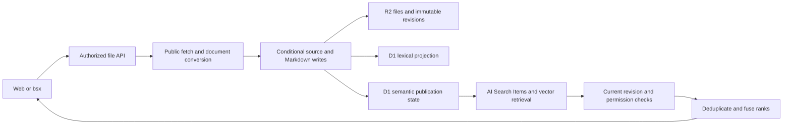

# Cloudflare ingestion and retrieval

The Rust Worker combines R2 source storage, the existing D1 index, Workers AI document conversion, and optional managed AI Search. The web app and remote `bsx` use the same protected file APIs. Configure these services with [cloudflare-services.json](examples/cloudflare-services.json) and the [resource profile](examples/cloudflare-free-2026-10-27.json); deployment steps are in [cloudflare.md](cloudflare.md).

## Source and projection ownership

R2 files and revisions are authoritative. D1 lexical rows and AI Search items are derived projections. The application publishes only committed, live, searchable text; it never connects the raw revision/blob bucket to a crawler. This keeps old revisions, trash, failed writes and unsupported attachments out of newly published search content.

`SemanticRetriever` owns publication, revision-specific removal, candidate retrieval and reconciliation. `ContentConverter` owns document conversion; `SourceFetcher` owns bounded public URL fetching. The composition root installs concrete providers from deployment configuration. SDK calls stay in the Cloudflare adapter, and authorization, conditional writes and source validation stay in the application.

## Conversion and URL import

`POST /api/v1/files/convert` reads one immutable attachment revision and writes a Markdown companion. The source is unchanged. The destination is captured before the provider call and saved conditionally; regeneration of unchanged content rechecks the destination revision before returning `unchanged: true`. Generated timestamps do not create new revisions by themselves.

`POST /api/v1/files/import/url` accepts a public HTTPS URL and an explicit destination. Fetches validate every redirect, check robots rules on each target, use a timeout and bound streamed response bytes. The Worker enables `global_fetch_strictly_public`; the robots parser is the maintained `robots-parser` package. Invalid input, forbidden targets and oversized responses retain their ordinary 400/403/413 error meanings. JavaScript-rendered pages are not rendered by this path.

For binary documents, the application preserves an original under `<destination>.sources/<sha256>.<extension>` with a create-only write. It reuses identical existing content and never overwrites an unrelated auxiliary file. The generated note records the remote URL, source hash, local original path and immutable revision. Text imports do not require permissions to an unused attachment sibling.

The source and note are separate commits. If the original is saved and the note commit fails, the response has `partial: true`, the saved source path/revision and the note error. CLI returns a nonzero result and the web dialog explains where the original was saved. Nothing rolls back or overwrites another writer's note.

Cloud conversion is advertised only when its provider is mounted. Image inference with opaque usage requires an explicit resource observation policy; strict profiles reject it before dispatch. Supported formats come from the provider's verified catalog, not from the native converter's broader format list. [Conversion binding and pricing](https://developers.cloudflare.com/workers-ai/features/markdown-conversion/).

## Managed semantic indexing

Each vault uses a dedicated upload-only AI Search instance. Item keys are `p1/<revision>.md`; pending publication state also identifies the vault, instance, model, dimensions and projection version. Upload acceptance means `queued`, not searchable. Reconciliation checks current HEAD again, observes processing status, removes obsolete revision items and retries eligible work.

Reconciliation atomically claims one due item using its existing D1 timestamp as a lease. Request completion can schedule it after mutations, and a five-minute cron resumes interrupted work. `reindex` rebuilds lexical rows and republishes current semantic projections. The Worker advertises a smaller reindex page maximum to stay within the Free plan's per-invocation D1 call limit; `bsx` respects the advertised value.

Changing or removing a file cannot make an old candidate visible: before returning a snippet, Brains loads its immutable revision and checks authorized scope, prefix, current live HEAD, revision equality, tags AND and lifecycle metadata. Failed or delayed provider cleanup can retain remote data temporarily, but that data is excluded from application responses. Removing a projection does not imply deletion of source history.

## Retrieval and model settings

The default model is AI Search's `@cf/qwen/qwen3-embedding-0.6b` at 1,024 dimensions. It needs no Google credential. Managed models have fixed adapter dimensions; unsupported overrides fail configuration. The configured model must match the actual instance. [Supported models](https://developers.cloudflare.com/ai-search/configuration/models/supported-models/).

The adapter requests vector-only candidates, sets `match_threshold: 0` when `minimum_score` is null, disables query rewriting, reranking and cache, and sets `return_on_failure: false`. Provider failures remain explicit instead of becoming successful empty results. By default it fetches up to 50 chunks, keeps each revision's highest-ranked chunk, validates up to 8 distinct sources and returns up to 5 fused results. Candidate retrieval, source validation and output limits are separate settings. Any bounded truncation is reported through `complete: false`; there is no semantic continuation cursor. [Search binding](https://developers.cloudflare.com/ai-search/api/search/workers-binding/).

The existing hybrid search uses rank fusion across literal, FTS and semantic lists. It does not compare unrelated raw scores or call sorting a model reranker. Source checks happen before snippets are constructed. Raw file responses derive bytes and ETag from the same snapshot, so MCP and clients cite the version actually read.

For optional Google Embedding 2 through managed AI Search, select `google-ai-studio/gemini-embedding-2`, 1,536 dimensions, a Gateway with Google BYOK and `external_usage: "observe"`. Brains cannot measure the external project's actual bill from managed calls; configure the provider's own budget separately. Strict default settings reject this opaque billing path. Model modalities and accepted adapter inputs are distinct: the Google model supports multiple modalities, while this Worker publishes and queries text.

A self-managed vector provider is an extension point, not a mounted backend in this release. The domain includes prefix-crop/L2 normalization for MRL-capable vectors. Native Google Embedding 2 can request reduced dimensions and automatically normalizes its output; self-managed Qwen requires cropping both document and query vectors consistently and normalizing afterward. Managed AI Search does not expose that dimension override. [Google dimensions](https://ai.google.dev/gemini-api/docs/embeddings#ensuring-quality-for-smaller-dimensions), [Qwen implementation](https://github.com/QwenLM/Qwen3-Embedding/blob/main/evaluation/qwen3_embedding_model.py).

## Budgets, Gateway and traces

The [quota reference](cloudflare-quotas.md) separates resource, measure, scope, window, provider limit and user policy. Its dated Free snapshot defaults to 80% of allowances, with per-rule overrides. D1 stores atomic consumption/reservation state; configuration edits do not reset it. `/api/v1/resources`, `bsx resources` and administrator settings expose rules, current usage, evidence and limitations.

AI Search query attempts can be reserved before dispatch. Managed ingestion tokens and image-model neurons are opaque. Strict mode pauses these operations; an explicit per-rule `when_charge_unknown: "observe"` allows estimated/unknown usage without claiming a hard billing bound. This is a deployment choice, not a successful indexing result.

AI Search's internal Workers AI embedding/reranking is included in AI Search usage. It is not charged again as standalone Workers AI/Vectorize work and does not appear in the user's Gateway inference logs. The dedicated Gateway disables caching, rate limits and payload collection by default. `toMarkdown` has its own documented conversion interface; it is traced without inventing unsupported Gateway options. [Gateway boundary](https://developers.cloudflare.com/ai-search/configuration/models/ai-gateway/).

Application spans cover conversion, public fetch, publication, query and removal. They contain operation names, not note bodies, query text, URLs or credentials. Workers logs and sampled traces remain platform telemetry, not durable business state or a complete quota ledger. Browser Run, standalone Vectorize, autonomous agents and answer generation remain optional extensions.

## Read-only MCP

The separate [MCP adapter](cloudflare-mcp.md) exposes `search`, `list_notes` and `read_note`. It authenticates incoming requests and uses a distinct upstream token containing only read scopes. An owner-only Access portal can aggregate these tools without bypassing Brains authorization or revision validation. Portal policies, tool availability and upstream credentials are separate controls.
